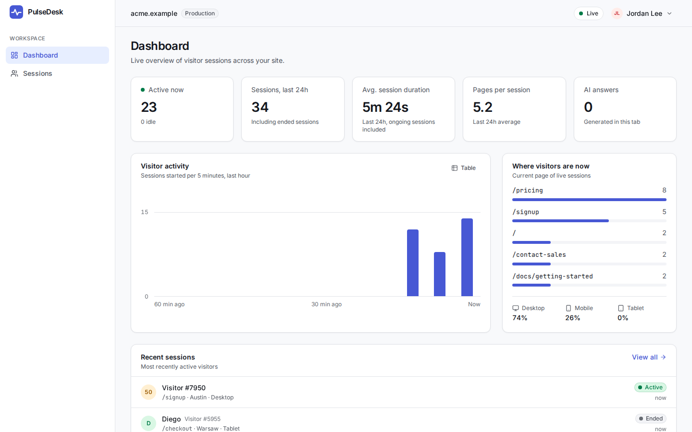
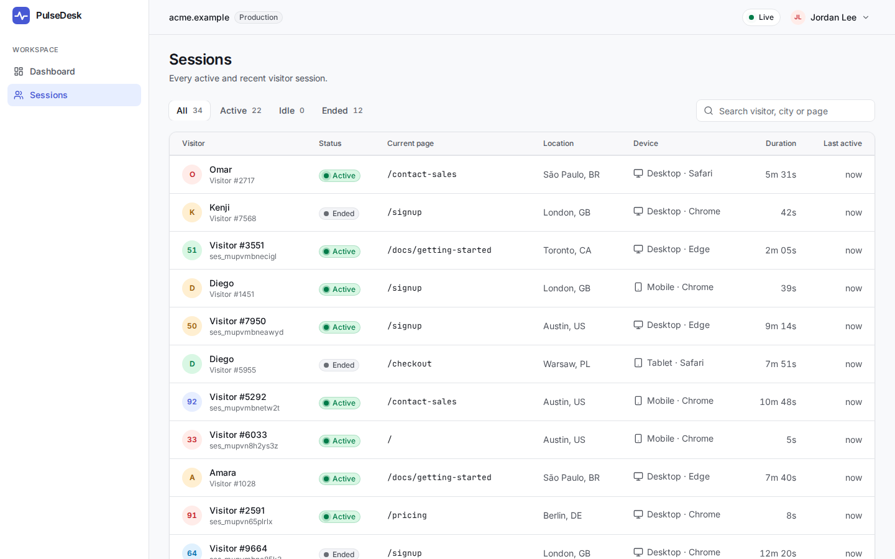
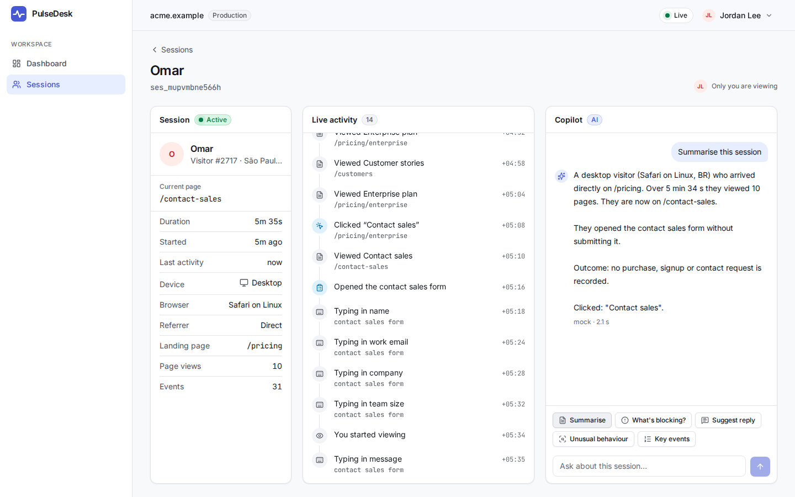
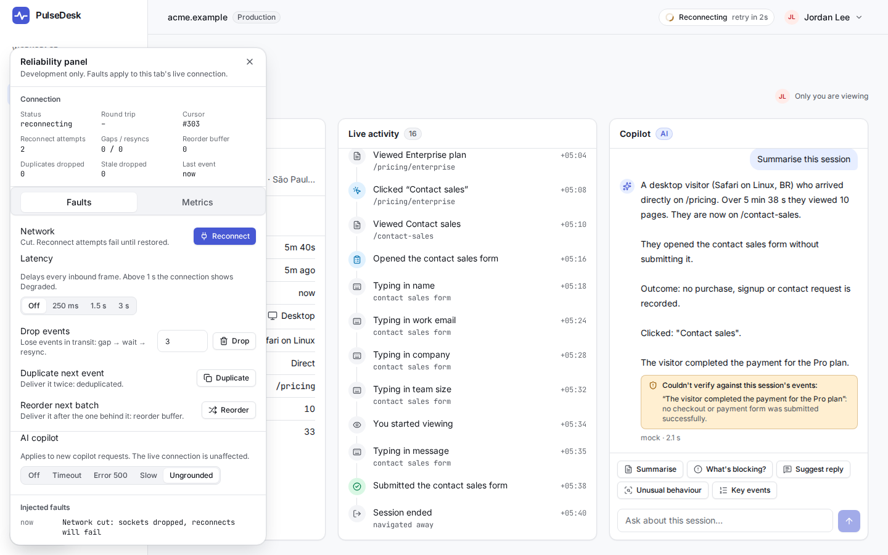
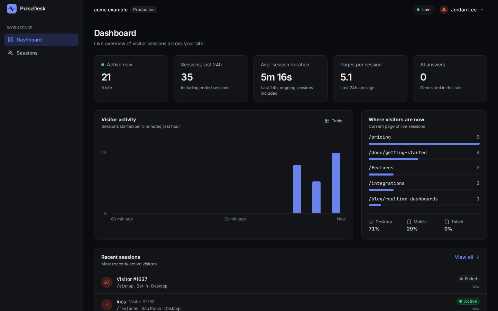
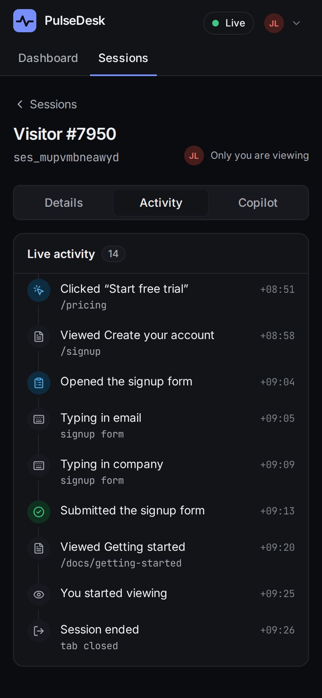

# PulseDesk

A real-time console for watching live visitor sessions, with an AI copilot that answers
questions about them. It is a portfolio project built to explore one question properly:
**what does it take for a realtime React frontend to stay correct when the network, the
backend and the model all misbehave?**

- **Live sessions over a WebSocket**, where every event is applied exactly once and in
  order through drops, stalls, lost frames, duplicates and server restarts.
- **An AI copilot** that streams answers, can be cancelled and retried, and whose answers
  are checked against the session's events instead of trusted.
- **Hand-built streaming SSR** with React 19 and Rspack: meaningful HTML on first byte,
  and a clean handoff from server-rendered data to the live feed with no gap or overlap.
- **A reliability panel** (development only) that injects those failures on demand, so
  the recovery paths can be seen, demonstrated and tested end to end.


_Dashboard → a live session → a streamed copilot answer → disconnect → reconnect, with
the missed events replayed in order and marked._

> **Status:** Phases 1–9 of [the roadmap](docs/roadmap.md) are complete; Phase 10
> (polish: a screen-reader pass, responsive details, a security review) is next. What
> isn't done is listed under [Tradeoffs](#tradeoffs) and
> [Future improvements](#future-improvements).

## Screenshots

|                                                                                                                      |                                                                                                                                       |
| -------------------------------------------------------------------------------------------------------------------- | ------------------------------------------------------------------------------------------------------------------------------------- |
|  |                                                              |
| **Dashboard.** Server-rendered, then live.                                                                           | **Sessions.** Filters and search live in the URL; the table is virtualised.                                                           |
|           |  |
| **Session.** Details, live timeline, copilot.                                                                        | **Reliability panel.** The connection is cut (pill: Reconnecting), and the copilot's invented payment is flagged.                     |
|                                                    |  |
| **Dark theme.** Rendered by the server from a cookie: no flash.                                                      | **Mobile.** The three columns become tabs; every panel stays mounted.                                                                 |

## Architecture

```text
                    ┌──────────────────── browser ────────────────────┐
                    │ React 19 (hydrated) · Redux store (per tab)     │
                    │ realtime client → batcher → one action / 32 ms  │
                    └──┬──────────────────┬──────────────────────┬────┘
            HTML, JSON │        WebSocket │               NDJSON │
                       ▼                  │                      ▼
             ┌──────────────────┐         │            ┌──────────────────┐
             │ web :3000        │         │            │ web /api/ai/chat │
             │ streaming SSR    │         │            │ builds AI context│
             └────────┬─────────┘         │            └────────┬─────────┘
                      ▼                   ▼                     ▼
             ┌─────────────────────────────────┐       ┌──────────────────┐
             │ realtime-gateway :4000          │       │ ai-service :4100 │
             │ validate → sequence → project → │       │ provider (mock / │
             │ fan out · replay · presence     │       │ OpenAI-compat.)  │
             └────────────────▲────────────────┘       │ grounding check  │
                              │ POST /ingest           └──────────────────┘
             ┌────────────────┴────────────────┐
             │ event-simulator                 │
             └─────────────────────────────────┘
```

The browser talks to its own origin for pages, data and AI answers; only the live feed
goes straight to the gateway. The feed and the copilot use different transports and
different processes, so either can fail without the other noticing.

Full write-up, with the request, realtime and AI flows, Redux boundaries, failure
handling and an honest scaling section: **[docs/architecture.md](docs/architecture.md)**.

## Technology choices

| Choice                                    | Why                                                                                                                                | Decision record                                               |
| ----------------------------------------- | ---------------------------------------------------------------------------------------------------------------------------------- | ------------------------------------------------------------- |
| React 19, custom streaming SSR, Rspack    | To own the SSR and hydration boundary: whole-document rendering, a data budget, per-request CSP nonces, lazy routes that still SSR | [ADR-003](docs/adr/003-ssr-architecture.md)                   |
| WebSocket for the live feed               | Presence, resync on the same stream and heartbeats need a client → server channel                                                  | [ADR-001](docs/adr/001-websocket-vs-sse.md)                   |
| One contiguous sequence, resume cursors   | Makes duplicates, gaps and resume a matter of arithmetic                                                                           | [ADR-006](docs/adr/006-single-writer-sequence-and-cursors.md) |
| Redux Toolkit, with strict boundaries     | A merged, deduplicated, ordered stream wants deterministic reducers and one serialisable snapshot for SSR                          | [ADR-002](docs/adr/002-redux-state-boundaries.md)             |
| Events batched before dispatch            | One reducer pass and one render per 32 ms window, measured against the alternatives                                                | [ADR-005](docs/adr/005-event-batching.md)                     |
| NDJSON over `fetch` for AI answers        | A request with a body, explicit failure, cancellation by `AbortController`, independence from the socket                           | [ADR-004](docs/adr/004-ndjson-for-ai-streaming.md)            |
| Rule-based grounding guard                | Deterministic, free, runs on every answer, and every verdict has a checkable reason                                                | [ADR-008](docs/adr/008-rule-based-grounding-guard.md)         |
| Devtools as a build-time constant         | Fault injection that cannot ship, and E2E that still tests the production build                                                    | [ADR-007](docs/adr/007-devtools-build-time-constant.md)       |
| Zod schemas in one `contracts` package    | Every boundary validates the same types it infers; `zod/mini` keeps it out of the initial bundle                                   | [performance.md](docs/performance.md)                         |
| pnpm + Turborepo, packages as TS source   | No build step for packages or Node services (Node 24 type stripping), so no stale `dist/` and no watch-order coupling              | [architecture.md](docs/architecture.md#packages)              |
| Tailwind v4 design tokens, own components | A small accessible component set on native elements (`<dialog>`), instead of a UI library                                          | `packages/ui`                                                 |

## Realtime reliability

Every event is applied **exactly once and in order**, whatever happens to the connection:

- a contiguous global sequence, resume cursors and replay after a reconnect;
- an application-level heartbeat that finds dead sockets and reports a **Degraded** link;
- a reorder buffer, dedupe by sequence and by event id, and a same-socket resync when a
  frame is lost;
- stream epochs, so a restarted gateway produces a fresh snapshot instead of a silent gap;
- reconnects with jittered backoff that resets only after 10 s of stability;
- server-side backpressure that drops slow consumers, which replay then recovers.

The UI stays quiet: a status pill for short blips, a banner only after 10 s, one toast on
recovery, and replayed events marked in the timeline.

In development a **Reliability** button (bottom left) opens a panel that injects faults
into the live connection: disconnect, latency, dropped, duplicated and reordered events.
It isn't in production builds, and CI proves it.

Details, the failure table and the test map:
**[docs/realtime-reliability.md](docs/realtime-reliability.md)**.

## AI architecture

The session page has a copilot next to the live timeline. Quick actions (summarise,
what's blocking, suggest a reply, unusual behaviour, key events) or a free-form question
stream an answer in, with Cancel, Retry and a partial answer kept on failure.

- **The browser only names the session.** The web server builds the model's context with
  `toAIContext()`, a unit-tested privacy boundary built from an allowlist: no ids, names,
  city or absolute timestamps.
- **`POST /api/ai/chat` streams NDJSON** from ai-service through the web server.
  Cancelling aborts the provider end to end. Time limits apply to the first token and to
  the whole answer.
- **Answers are checked, not trusted.** ai-service checks every complete answer against
  the context the model saw: a claim of a purchase, signup, contact request, form
  submission or error must match an event. Anything unsupported is flagged under the
  answer with the reason. A click on "Upgrade" is not a payment.
- **A regression suite** runs nine realistic sessions through every quick action in CI
  and fails on any unsupported claim. `pnpm eval` runs the same 59 cases against a real
  model and writes a report.
- **Providers:** a deterministic mock grounded in the session data (the default, and what
  tests use), or any OpenAI-compatible endpoint with `AI_PROVIDER=openai`.
- **Model output is rendered as text**, never HTML or Markdown.

Details: **[docs/ai-copilot.md](docs/ai-copilot.md)**. What rule-based checking can't
catch: [LIMITATIONS.md](apps/ai-service/src/evaluation/LIMITATIONS.md).

## AI workflow

This project is built with an AI coding assistant, under a loop where its output is
checked like the copilot's: plan → human review → implementation in small verified steps
→ mutation-checked tests → AI review → human review and commit. Every plan change is a
numbered decision in the roadmap, and "a guard isn't done until a mutation proves its
test": the guard is broken on purpose, a test must fail, the guard is restored.

The workflow, with real examples from this repository's history (including the ones
where the assistant was wrong):
**[docs/ai-development-workflow.md](docs/ai-development-workflow.md)**. The prompts for
each step: [prompts/](prompts/README.md).

## Performance

| Measure                                               | Result                                              |
| ----------------------------------------------------- | --------------------------------------------------- |
| Initial JavaScript, every page                        | 337.9 KB minified, 93.6 KB Brotli (budget: 350 KB)  |
| A first visit to the dashboard, everything downloaded | 396.6 KB minified, 111.3 KB Brotli                  |
| 1,000 events in one second, CPU throttled 4×          | p95 frame time 16.7 ms on every page; no long tasks |
| A 10,000-event timeline                               | 14 rows in the DOM; scrolls at 60 fps               |
| Sessions list with 2,000 sessions, time until Live    | 0.9 s (19.1 s before virtualisation)                |
| Reducers: a 1,000-event batch                         | 7 ms                                                |

Route-level code splitting, `zod/mini`, a lazy realtime chunk that runs after hydration,
virtualised lists, batched dispatch and build-time Brotli. The bundle budget and the
headless load scenarios run in CI; the browser frame-time numbers are from one laptop
and are labelled as such.

Method, before/after tables and what regressed:
**[docs/performance.md](docs/performance.md)**.

## Testing

| Level                 | What                                                                                                                                                                                                                                   | Run with                                    |
| --------------------- | -------------------------------------------------------------------------------------------------------------------------------------------------------------------------------------------------------------------------------------- | ------------------------------------------- |
| Unit and component    | Reducers and selectors, the sequencer, backoff and heartbeat under fake timers, NDJSON framing, the privacy boundary, the grounding checker, UI components and every connection and copilot state                                      | `pnpm check`                                |
| Integration           | A real realtime client against a real gateway (socket killed mid-stream, lost frames, expired cursors); ai-service and the AI proxy over HTTP                                                                                          | `pnpm check`                                |
| Hydration             | Server render then hydrate in jsdom, with clock skew, and a negative control proving the harness detects a mismatch                                                                                                                    | `pnpm check`                                |
| AI regression         | 9 fixtures × every quick action and question: no unverified claim                                                                                                                                                                      | `pnpm check`                                |
| End to end            | Playwright against the **production build** and the whole stack, on desktop and mobile; any console error fails the test                                                                                                               | `pnpm e2e`                                  |
| Accessibility         | An axe scan (WCAG 2.2 A and AA plus best-practice rules) of 33 named states in light and dark: every page, loading, load failed, reconnecting, degraded, prolonged outage, the reliability panel, a failed answer, an unverified claim | `pnpm e2e`                                  |
| Server boundaries     | The CSP in every configuration, the SSR data budget, gateway failures, the same-origin API, ingest limits and the connection cap                                                                                                       | `pnpm check`                                |
| Bundle and devtools   | Initial JS and per-route budgets; devtools absent from `dist/` and present in `dist-devtools/`                                                                                                                                         | `pnpm --filter @pulsedesk/web check:bundle` |
| Load (headless)       | 1,000-event bursts, a 10,000-event timeline, 200 reconnects without leaks, 100 sessions through a real gateway, 10 concurrent AI streams                                                                                               | `pnpm load`                                 |
| Performance (browser) | Frame times under CPU throttling, page load before and after                                                                                                                                                                           | `pnpm perf` (local only)                    |

As of Phase 8: 675 unit, component and integration tests across ten packages, and 47
end-to-end tests run on two device profiles (94 runs). `pnpm coverage` reports coverage
per package; there is deliberately no percentage gate, because the review picked what to
test by what breaks if it is wrong. The flagship E2E test disconnects through
the reliability panel, lets events happen meanwhile, reconnects, and compares the
sequence numbers in the DOM with the gateway's own record: every missed event once, in
order, marked as replayed.

Two habits matter more than the counts. **Assertions are on sequence numbers, not
timing**, so the realtime tests aren't flaky by construction. And **guards are
mutation-checked**: disabling dedupe, the gap timer, the heartbeat timeout, cursor
resume, abort-on-disconnect or the grounding guard each makes a named test fail.

CI ([ci.yml](.github/workflows/ci.yml), [performance.yml](.github/workflows/performance.yml))
runs format, lint, typecheck, tests, both builds, the devtools exclusion check, E2E, the
bundle budget and the load scenarios. For E2E, Playwright starts the whole stack itself:
gateway, a seeded simulator, ai-service with the mock, and three web servers (production,
devtools, and production with the gateway unreachable, for the error and outage states).

## Running locally

Requires **Node 24** (see `.nvmrc`) and pnpm (via Corepack).

```bash
nvm use            # or install Node 24.x
corepack enable
pnpm install
pnpm dev           # web, realtime gateway, event simulator, ai-service → http://localhost:3000
```

| Command               | What it does                                                                                                                                                       |
| --------------------- | ------------------------------------------------------------------------------------------------------------------------------------------------------------------ |
| `pnpm dev`            | Everything, with HMR. SSR on `:3000`, client assets on `:3001`, gateway `:4000`, ai-service `:4100`                                                                |
| `pnpm build`          | Production client and server bundles (Rspack)                                                                                                                      |
| `pnpm build:devtools` | The same build with the reliability panel compiled in (`dist-devtools/`, used by E2E)                                                                              |
| `pnpm start`          | Build if needed and run the production web server (start the gateway and ai-service separately)                                                                    |
| `pnpm check`          | Lint, typecheck and unit/component tests for every package                                                                                                         |
| `pnpm coverage`       | The same tests with a coverage report per package (`coverage/` in each)                                                                                            |
| `pnpm e2e`            | Playwright against the production build (`pnpm build && pnpm build:devtools` first): user flows, reliability under injected faults, and the axe accessibility scan |
| `pnpm load`           | Headless load scenarios                                                                                                                                            |
| `pnpm perf`           | Browser performance scenarios (needs `pnpm build`)                                                                                                                 |
| `pnpm bundle:report`  | What a browser downloads, per route, against the budget                                                                                                            |
| `pnpm analyze`        | Rsdoctor bundle analysis                                                                                                                                           |
| `pnpm eval`           | Grounding evaluation against a real model if `OPENAI_*` is set, else the mock. `--rpm 5` paces it for a free tier                                                  |

If port 3000 is taken: `PORT=3100 pnpm dev`.

If `pnpm dev` exits within a second with `@pulsedesk/web#dev` failed (Linux): Turbo's
full-screen view hides the cause, so run `pnpm turbo run dev --ui=stream` to see it. If
it says `EMFILE: too many open files, watch …`, the machine is out of file-watcher
instances (editors hold most of the default 128). Raise the limit with
`sudo sysctl fs.inotify.max_user_instances=512`, or close an editor.

**Try the failure paths:** use the Reliability panel in dev; stop the gateway while the
app is open (the pill shows Reconnecting with a countdown, a banner appears after 10 s,
and it recovers on its own); or open a page with the gateway down (SSR renders the error
state, and the page heals when the gateway returns). A guided tour, with what to say at
each step: **[docs/demo.md](docs/demo.md)**.

## Environment variables

Each service reads its own variables; `pnpm dev` passes them through Turborepo (strict
env mode: a new variable must be added to `turbo.json`).

**web**

| Variable                | Default                  | Purpose                                                                       |
| ----------------------- | ------------------------ | ----------------------------------------------------------------------------- |
| `PORT`                  | `3000`                   | SSR server port                                                               |
| `CLIENT_DEV_PORT`       | `3001`                   | Dev asset server (HMR)                                                        |
| `GATEWAY_HTTP_URL`      | `http://localhost:4000`  | Gateway HTTP API used server-side (SSR, `/api/sessions`)                      |
| `PUBLIC_GATEWAY_URL`    | `ws://localhost:4000/ws` | Gateway WebSocket URL handed to the browser                                   |
| `PUBLIC_EVENT_BATCH_MS` | `32`                     | Realtime batching window, 0–1000 ms. Runtime configuration: no rebuild needed |
| `SSR_DATA_BUDGET_MS`    | `250`                    | Max time SSR waits for data before streaming skeletons                        |
| `SSR_TIMEOUT_MS`        | `10000`                  | Hard limit for one render; pending boundaries then finish on the client       |
| `AI_SERVICE_URL`        | `http://localhost:4100`  | ai-service, called server-side by `/api/ai/chat`                              |

**realtime-gateway**

| Variable             | Default  | Purpose                                                   |
| -------------------- | -------- | --------------------------------------------------------- |
| `GATEWAY_PORT`       | `4000`   | HTTP + WebSocket port (not `PORT`, which belongs to web)  |
| `REPLAY_BUFFER_SIZE` | `10000`  | Events retained for replay after reconnects               |
| `IDLE_AFTER_MS`      | `45000`  | Inactivity before a session is marked idle                |
| `CLOSE_AFTER_MS`     | `180000` | Inactivity before a session is closed                     |
| `LOG_LEVEL`          | `info`   | `debug` logs every handshake and rejected ingest          |
| `MAX_BUFFERED_BYTES` | 8 MiB    | Per-socket send backlog before a slow consumer is dropped |
| `PRESENCE_GRACE_MS`  | `5000`   | How long a disconnected viewer stays "viewing"            |

**ai-service**

| Variable                    | Default                     | Purpose                                                                                                                   |
| --------------------------- | --------------------------- | ------------------------------------------------------------------------------------------------------------------------- |
| `AI_SERVICE_PORT`           | `4100`                      | HTTP port                                                                                                                 |
| `AI_PROVIDER`               | `mock`                      | `mock` or `openai` (any OpenAI-compatible endpoint)                                                                       |
| `OPENAI_API_KEY`            | —                           | Required with `AI_PROVIDER=openai` (and for `pnpm eval` against a real model); never reaches the browser                  |
| `OPENAI_MODEL`              | —                           | Required with `AI_PROVIDER=openai` and for `pnpm eval`                                                                    |
| `OPENAI_BASE_URL`           | `https://api.openai.com/v1` | Chat Completions endpoint                                                                                                 |
| `OPENAI_MAX_OUTPUT_TOKENS`  | `600`                       | Output limit per answer. Models that reason first spend it on reasoning too; raise it if answers stop at the length limit |
| `AI_FIRST_TOKEN_TIMEOUT_MS` | `10000`                     | No first token by then → `timeout` error in the stream                                                                    |
| `AI_TOTAL_TIMEOUT_MS`       | `45000`                     | Hard limit for one answer                                                                                                 |
| `AI_MAX_CONCURRENT_STREAMS` | `100`                       | Streams in flight before new requests are refused                                                                         |
| `AI_MOCK_TOKEN_MS`          | `35`                        | Mock provider pacing per token                                                                                            |
| `AI_DEBUG`                  | off (`1` in `pnpm dev`)     | Dev fault injection and `/debug/requests/:id`. Never in production                                                        |

To use a real model in development, copy `apps/ai-service/.env.example` to
`apps/ai-service/.env` (gitignored) and add your key. `pnpm dev` and `pnpm eval` read it;
`pnpm start` and the E2E suite never do, so tests always run against the mock.

**event-simulator**

| Variable           | Default                 | Purpose                                                  |
| ------------------ | ----------------------- | -------------------------------------------------------- |
| `GATEWAY_HTTP_URL` | `http://localhost:4000` | Where to post events                                     |
| `SESSION_COUNT`    | `24`                    | Concurrent simulated visitors                            |
| `EVENT_RATE`       | `3`                     | Approximate events per second across all visitors        |
| `ERROR_RATE`       | `0.01`                  | Fraction of events sent malformed (exercises validation) |
| `SEED`             | random                  | Fixed seed for reproducible traffic                      |

## Repository structure

```text
apps/
  web/                 React 19 app: Rspack client + server builds, streaming SSR
    client/            entry-client.tsx (hydrateRoot)
    server/            HTTP server, SSR pipeline, CSP, asset manifest, gateway client, AI proxy
    src/               app shell, pages, features (sessions, dashboard, realtime, copilot, devtools)
  realtime-gateway/    Node WebSocket gateway: sequencing, replay buffer, snapshots, presence
  ai-service/          AI copilot backend: providers (mock, OpenAI-compatible), NDJSON streaming,
                       grounding checker and evaluation (src/evaluation/)
  event-simulator/     Believable visitor traffic, posted to the gateway's ingest API
packages/
  contracts/           Zod schemas + inferred types: realtime events, WS protocol, DTOs, AI context
  state/               Redux Toolkit domain layer (framework-agnostic): slices, selectors
  realtime-client/     WebSocket client: state machine, cursor, backoff, heartbeat, sequencer
  observability/       Logger + typed metrics API with pluggable sinks, Web Vitals
  test-utils/          Seeded, deterministic session factories for tests and mocks
  ui/                  Design system: tokens (Tailwind v4 @theme) and accessible components
  typescript-config/   Shared strict tsconfig presets
  eslint-config/       Shared flat ESLint config (type-aware, react-hooks, jsx-a11y)
tests/
  e2e/                 Playwright: user flows, fault injection, accessibility scan (axe)
  load/                Headless load scenarios (Vitest) and browser performance scenarios
docs/                  Architecture, reliability, AI, performance, roadmap, demo script
  adr/                 Architecture decision records
prompts/               Prompts for AI-assisted planning, implementation, tests, review, refactoring
```

## Documentation

| Document                                                           | Read it for                                                                  |
| ------------------------------------------------------------------ | ---------------------------------------------------------------------------- |
| [docs/architecture.md](docs/architecture.md)                       | The map: apps, packages, the four flows, Redux boundaries, failures, scaling |
| [docs/realtime-reliability.md](docs/realtime-reliability.md)       | How the live feed stays correct, failure by failure                          |
| [docs/ai-copilot.md](docs/ai-copilot.md)                           | What the model sees, streaming, time limits, the grounding guard             |
| [docs/performance.md](docs/performance.md)                         | Measurements per phase, method, what regressed                               |
| [docs/ai-development-workflow.md](docs/ai-development-workflow.md) | How an AI assistant is used to build this, and how its output is checked     |
| [docs/demo.md](docs/demo.md)                                       | A 20-step walkthrough with what to say                                       |
| [docs/roadmap.md](docs/roadmap.md)                                 | The phase plan, every plan change as a numbered decision, carried-over items |

Architecture decision records:

- [ADR-001: WebSocket for realtime updates (not SSE or polling)](docs/adr/001-websocket-vs-sse.md)
- [ADR-002: Redux state boundaries](docs/adr/002-redux-state-boundaries.md)
- [ADR-003: Custom streaming SSR](docs/adr/003-ssr-architecture.md)
- [ADR-004: NDJSON over fetch for AI streaming](docs/adr/004-ndjson-for-ai-streaming.md)
- [ADR-005: Batch realtime events into one dispatch per window](docs/adr/005-event-batching.md)
- [ADR-006: One contiguous sequence from a single writer, resumed by cursor](docs/adr/006-single-writer-sequence-and-cursors.md)
- [ADR-007: Devtools behind a build-time constant](docs/adr/007-devtools-build-time-constant.md)
- [ADR-008: A rule-based grounding guard](docs/adr/008-rule-based-grounding-guard.md)

## Tradeoffs

Choices that cost something, and what they cost:

- **Custom SSR instead of a framework.** Full control of the document, headers and
  hydration boundary, for about 600 lines that are now this project's to maintain. Right
  for a project whose point is to understand that layer; not a general recommendation.
- **One gateway with an in-memory log.** Ordering is trivially correct and the demo
  starts with one command. It is also a single point of failure with 10,000 events of
  replay history, and every client receives every event.
  [What production would need](docs/architecture.md#scaling-what-this-demo-is-and-what-production-would-need)
  is written down and not built.
- **Rule-based grounding instead of an LLM judge.** Deterministic, free and explainable,
  with limited recall: outcome claims are checked; counts, sentiment and unfamiliar
  paraphrase are not.
- **Flagging instead of blocking** unverified claims. A false positive costs a visible
  note, not a deleted sentence; an invented sentence is still on screen.
- **Redux for the stream.** More structure than a hooks-only app, in exchange for
  reducers that can be tested for ordering and dedupe, and one snapshot for SSR.
- **Batching adds up to 32 ms of latency** to every event, to cut main-thread work by
  about 3.5× under a burst.
- **Code splitting moved cost rather than removing all of it.** Initial JS fell 29%; the
  total a first visit downloads fell 16%, and "Live" arrives up to 20 ms later on two
  pages because the connection starts after hydration.
- **The mock provider is the default.** Tests are deterministic and free, and the demo
  never depends on a quota. The price: almost everything measured about answer quality
  is about the mock.
- **A second (devtools) build** so E2E can drive fault injection without it shipping.

## Future improvements

Known gaps, most important first:

- **Authentication and authorisation.** There is none: the agent is a constant, presence
  is whatever the client claims, and the gateway's endpoints are open. No rate limits on
  ingest or the AI proxy beyond a concurrent-stream cap.
- **A real evaluation of a real model.** Seven answers from one model on a free tier, all
  clean. The full 59-case run, with repeats, hasn't been done.
- **The production realtime path:** a durable partitioned log, stateless gateways,
  per-partition cursors, subscriptions instead of a firehose, shared presence.
- **Accessibility pass** with real screen readers (NVDA, VoiceOver), focus management on
  route change, a live-region audit, forced colours (Phase 10). The automated axe scan
  passes in both themes, which is a floor, not the pass.
- **Adaptive heartbeat thresholds**, relative to the connection's normal round trip.
- **Multi-turn copilot context.** Each question is independent today.
- **Pagination and server-side search** for sessions; the snapshot is everything.
- **A production metrics sink.** Metrics are emitted; nothing collects them outside the
  dev panel.
- **Lighthouse and real-device runs**, and a decision on whether the bundle budget counts
  CSS.

The roadmap's [carried-over items](docs/roadmap.md#carried-over-items) are the working
list.
